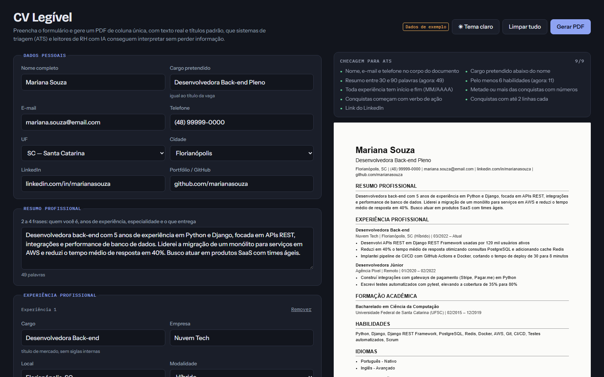

# CV Legível

Gerador de currículo que roda direto no navegador. Você preenche um formulário e baixa um PDF pensado para ser lido por **ATS** (Applicant Tracking Systems), os sistemas de triagem automática, e por ferramentas de RH baseadas em IA.

**[▶ Usar online](https://DutraGabriel.github.io/cv-legivel/)**



## Por que existe

Grande parte dos currículos passa primeiro por um software antes de chegar a uma pessoa. Layouts com duas colunas, tabelas, ícones ou texto dentro de imagens costumam ser lidos fora de ordem ou simplesmente ignorados. O CV Legível gera um PDF que fica bonito para quem lê e continua fácil de interpretar para quem faz o parsing.

## Funcionalidades

- **Prévia ao vivo** em folha A4, atualizada enquanto você digita.
- **PDF com texto real**, gerado com [jsPDF](https://github.com/parallax/jsPDF). Não é print de tela nem imagem.
- **Checagem ATS em tempo real.** Mostra se o resumo tem tamanho adequado, se as conquistas trazem números e começam com verbo de ação, se as datas estão completas, entre outros pontos.
- **Formatação automática enquanto você digita.** Telefone vira `(48) 99618-7500` e datas viram `MM/AAAA`, no campo e no PDF.
- **UF e cidade em listas**, com todos os municípios do Brasil carregados da [API de localidades do IBGE](https://servicodados.ibge.gov.br/api/docs/localidades) conforme a UF escolhida.
- **Local e modalidade separados** em cada experiência (Presencial, Híbrido ou Remoto), saindo como `Florianópolis, SC (Híbrido)` no PDF.
- **Exemplos em todos os campos**, escritos seguindo boas práticas para ATS e leitura por IA: título de cargo de mercado, conquistas com verbo de ação e números, nomes oficiais de instituições e certificações.
- **Rascunho salvo automaticamente** no `localStorage`. Os dados do currículo não saem do seu navegador.
- **Tema claro e escuro**, seguindo o sistema ou escolhido no botão do topo (a escolha fica salva).
- **Layout que aproveita a tela toda**: no computador, formulário e prévia lado a lado, com a prévia acompanhando a rolagem; em telas muito largas, o formulário se divide em duas colunas; no celular e no tablet, abas **Editar** e **Prévia e checagem**.
- **Zero build.** HTML, CSS e JavaScript puros.

## Decisões de formatação para ATS

| Decisão | Motivo |
|---|---|
| Coluna única, sem tabelas nem ícones | Parsers leem de cima para baixo. Colunas lado a lado embaralham a ordem do texto. |
| Títulos de seção padrão ("Experiência profissional", "Formação acadêmica"…) | É assim que os sistemas identificam cada bloco. Títulos criativos não são reconhecidos. |
| Contato no corpo, não em cabeçalho/rodapé | Muitos ATS descartam cabeçalhos e rodapés do PDF. |
| Datas no formato `MM/AAAA – MM/AAAA` | Formato consistente permite calcular o tempo de experiência. O dia não é pedido, porque não é relevante num currículo. |
| Telefone com DDD no formato `(DD) 9XXXX-XXXX` | Padrão brasileiro reconhecido por parsers e fácil de ler. |
| Local e modalidade no mesmo padrão em todas as experiências | Facilita filtros por cidade e por trabalho remoto ou presencial. |
| Fonte padrão (Helvetica) | Garante a extração correta de acentos e caracteres. |
| Metadados do PDF (título, autor, palavras-chave) | Dá contexto extra para indexação. |
| Nome do arquivo `Nome-Sobrenome-Curriculo.pdf` | Facilita a identificação pelo recrutador. |

Para validar, você pode extrair o texto do PDF gerado (por exemplo com `pdftotext` ou `pypdf`). Ele sai na mesma ordem e com a mesma estrutura da prévia.

## Como rodar localmente

```bash
git clone https://github.com/DutraGabriel/cv-legivel.git
cd cv-legivel
python3 -m http.server 8000   # ou abra o index.html direto no navegador
```

Depois acesse `http://localhost:8000`.

É preciso ter internet para carregar as fontes, a biblioteca de PDF (jsPDF, via CDN) e a lista de cidades do IBGE. Sem conexão, o formulário funciona, mas o botão **Gerar PDF** e a lista de cidades não.

## Estrutura

```
cv-legivel/
├── index.html            # marcação do formulário e da prévia
├── assets/
│   ├── css/styles.css    # tokens de cor, tema claro/escuro, layout
│   └── js/app.js         # estado, máscaras, UF/cidade, prévia, checagem ATS e PDF
└── docs/screenshot.png
```

A prévia em HTML e o PDF saem da **mesma função `model()`**. Ela normaliza os dados do formulário em seções, e os dois renderizadores apenas desenham essa estrutura. Assim, o que você vê é o que vai para o PDF.

Rascunhos salvos por versões anteriores são convertidos ao carregar a página: `"Florianópolis, SC"` é separado em UF e cidade, `"Florianópolis, SC (híbrido)"` em local e modalidade, e datas `2022-03` viram `03/2022`.

## Próximos passos

- [ ] Comparar o currículo com a descrição de uma vaga e destacar as palavras-chave ausentes
- [ ] Importar e exportar os dados em JSON
- [ ] Versão em inglês do currículo
- [ ] Mais de um modelo visual, todos compatíveis com ATS
- [ ] Testes automatizados da geração do PDF

## Licença

[MIT](LICENSE)
